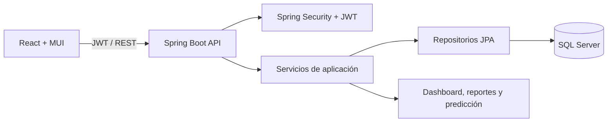

# FinanceTrack

Aplicación web para administrar ingresos, gastos, presupuestos y hábitos financieros. El repositorio contiene API Spring Boot 3 / Java 21, cliente React/Vite, esquema SQL Server, Docker Compose y documentación.

## Arquitectura



La API separa controladores, servicios, repositorios, entidades y DTOs; las entidades no se exponen directamente. Las consultas financieras están limitadas al usuario autenticado. `ADMIN` es un rol de plataforma y no concede acceso a datos financieros ajenos.

## Casos de uso

- Registro, login, renovación de token y logout.
- CRUD y búsqueda por fecha/categoría de ingresos y gastos.
- Dashboard con saldo, ahorro y distribución de gastos.
- Presupuestos por categoría y notificación al alcanzar o superar el límite.
- Resumen histórico, distribución de gastos y estimación sencilla por promedio de seis meses.
- Gestión básica de perfil (nombre, correo y contraseña).
- Presupuestos por categoría con indicador de exceso.

## Modelo ER

```mermaid
erDiagram
  USERS ||--o{ USER_ROLES : has
  ROLES ||--o{ USER_ROLES : grants
  USERS ||--o{ INCOME : owns
  USERS ||--o{ EXPENSES : owns
  USERS ||--o{ BUDGETS : defines
  USERS ||--o{ PREDICTIONS : receives
  USERS ||--o{ NOTIFICATIONS : receives
  USERS ||--|| USER_SETTINGS : configures
  CATEGORIES ||--o{ INCOME : classifies
  CATEGORIES ||--o{ EXPENSES : classifies
  CATEGORIES ||--o{ BUDGETS : limits
  USERS { bigint id PK }
  ROLES { bigint id PK }
  CATEGORIES { bigint id PK }
  INCOME { bigint id PK; bigint user_id FK; bigint category_id FK }
  EXPENSES { bigint id PK; bigint user_id FK; bigint category_id FK }
  BUDGETS { bigint id PK; bigint user_id FK; bigint category_id FK }
  PREDICTIONS { bigint id PK; bigint user_id FK }
  NOTIFICATIONS { bigint id PK; bigint user_id FK }
  USER_SETTINGS { bigint user_id PK_FK }
```

## Requisitos

- JDK 21, Maven 3.9+, Node.js 20+ y SQL Server Express instalado como instancia `SQLEXPRESS`.
- Copiar `backend/.env.example` a `backend/.env` y configurar secretos antes de desplegar.

## Inicio rápido

Para iniciar SQL Server con Docker Compose, copia `.env.example` como `.env`, configura una contraseña segura para `MSSQL_SA_PASSWORD` y ejecuta `docker compose up -d`. No publiques el archivo `.env`.

1. En `Ctrl+Shift+P`, elige **Tasks: Run Task** y ejecuta **FinanceTrack: Preparar SQL Server local (aceptar aviso de Windows)** una vez. Acepta el aviso UAC de Windows. El script activa TCP solo en localhost, crea el esquema, concede lectura y escritura a la cuenta exclusiva de la app y guarda la contraseña aleatoria en `backend/local.properties` (ignorado por Git).
2. Ejecuta **FinanceTrack: Iniciar aplicación** desde **Terminal > Run Task...**. Se abrirán terminales para backend y frontend.
3. Abre `http://localhost:5173`; Swagger UI está en `http://localhost:8080/swagger-ui.html`.

### Ejecutar desde Visual Studio Code

1. Instala las extensiones **Extension Pack for Java** y **Spring Boot Extension Pack**, JDK 21, Maven 3.9+ y Node.js 20+ (incluye npm); verifica que `mvn` y `npm` estén en el PATH.
2. Abre la carpeta `financetrack` en VS Code con **File > Open Folder**.
3. En la terminal integrada, ejecuta una vez `npm install` desde `frontend`.
4. Ejecuta **Terminal > Run Task... > FinanceTrack: Preparar SQL Server local (aceptar aviso de Windows)** y acepta el aviso UAC.
5. Selecciona **Terminal > Run Task... > FinanceTrack: Iniciar aplicación**. VS Code abrirá terminales para backend y frontend.
6. Abre `http://localhost:5173` en el navegador.

También puedes iniciar por separado las tareas **FinanceTrack: Backend** y **FinanceTrack: Frontend**. Deja las terminales activas mientras usas la aplicación.

La API usa `ddl-auto=validate`: aplica el script antes de arrancar. Credenciales iniciales de roles y categorías vienen en el script; no se crea ningún usuario con contraseña predeterminada.

## Configuración y seguridad

Variables: `DB_URL`, `DB_USERNAME`, `DB_PASSWORD`, `JWT_SECRET` (mínimo 32 bytes aleatorios), `JWT_ACCESS_MINUTES`, `CORS_ALLOWED_ORIGINS`. Para desarrollo local, `backend/local.properties` mantiene la credencial generada fuera del repositorio. En producción usar secretos del entorno, HTTPS y respaldos de SQL Server. El access token de vida breve se guarda en sessionStorage y logout elimina la sesión del navegador; esta versión no ofrece refresh token ni revocación del JWT antes de su expiración.

Los endpoints `/api/auth/**` y documentación son públicos; los demás requieren JWT. `GET/POST/PUT/DELETE /api/income`, `/api/expenses`, `/api/budgets`, `/api/profile`, `/api/dashboard`, `/api/reports`, `/api/predictions` están protegidos. Validación Bean Validation y errores JSON globales.

## Verificación

Verificación prevista: `cd backend && mvn test`; `cd frontend && npm install && npm test && npm run build`. En el entorno de creación no estaban instalados Maven ni npm, por lo que la compilación y las pruebas aún deben ejecutarse en un equipo con esos requisitos. Añadir pruebas de integración con SQL Server, revisión de seguridad, carga y accesibilidad antes de producción.

## Estructura

`backend/src/main/java/com/financetrack` conserva los paquetes config, security, controller, dto, entity, mapper, repository, service, serviceImpl, exception, util y validation. `frontend/src` sigue components, pages, layouts, services, hooks, context, routes, assets, utils y styles.

## Alcance pendiente antes de producción

- Refresh token seguro y revocación real de sesión; rol ADMIN con asignación administrativa controlada.
- Pantallas de presupuesto y perfil, gestión de moneda/salario/meta de ahorro.
- Reportes mensuales/anuales exportables a PDF y XLSX; alertas persistentes para variaciones y ahorro.
- Dashboard con series históricas de ingresos, gastos y ahorro; predicción actual es un promedio simple.
- Suite automatizada de pruebas y pipeline CI/CD.

## Mejoras posteriores

- MFA, detección de anomalías configurable y consentimiento para notificaciones push.
- Importación bancaria y conciliación, auditoría de cambios y observabilidad.
- Exportación PDF y XLSX con plantillas, además de cuotas por plan.
- Multi-moneda con conversión histórica y presupuestos compartidos.
